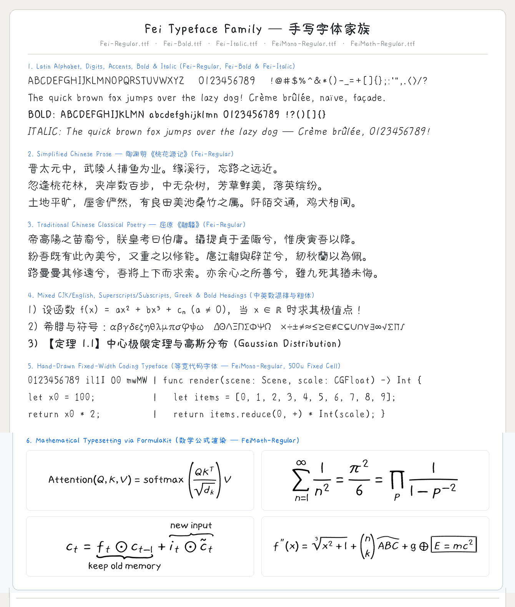

# Fei Typeface Family (手写字体家族)

**Fei** is a unified, cozy hand-drawn OpenType & TrueType typeface family designed for high visual comfort across **Simplified Chinese**, **Traditional Chinese**, **English / Latin**, **Greek**, **Source Code (Monospace)**, and **Mathematical Typesetting**.



---

## Fonts in This Repository

| Font File | Style / Weight | Glyphs | File Size | Description |
| :--- | :--- | ---: | ---: | :--- |
| **`Fei-Regular.ttf`** | Regular (`400`) | `18,658` | `9.4 MB` | Primary text font covering Latin, Greek, Symbols, Simplified Chinese (GB2312), and Traditional Chinese (Big5). |
| **`Fei-Bold.ttf`** | Bold (`700`) | `18,658` | `10.6 MB` | Companion bold weight for headings, emphasis, and UI titles with counter-preserving bold strokes. |
| **`Fei-Italic.ttf`** | Italic (`400`) | `589` | `114 KB` | Hand-drawn italic companion covering Latin, Accented Latin, Greek, Cyrillic, and Punctuation (zero CJK duplication). |
| **`FeiMono-Regular.ttf`** | Monospace (`400`) | `733` | `140 KB` | Fixed-width (`500u` cell) hand-drawn coding typeface with disambiguated `0` (center dot), `1`, `l`, `i`, and box-drawing glyphs. |
| **`FeiMath-Regular.ttf`** | Math (`400`) | `6,611` | `1.4 MB` | Full OpenType `MATH` font with mathematical alphanumerics, script variants (`.ssty` / `.ssty2`), extensible delimiters (`.s1–.s12`), radicals, and display operators. |

---

## Key Design & Typographic Features

1. **Unified Anime / Cozy Hand-Drawn Aesthetic**:
   - **Round Capsule Terminals & Corner Filleting (`外圆内明、圆珠收笔`)**: Sharp calligraphic needles (`撇, 捺, 提, 钩`) and $90^\circ$ box shoulders (`横折`) are remodeled into soft, plump felt-marker capsule terminals while inner counters (`口, 日, 目`) remain crisp and open.
   - **Open-Core & High-Waist Proportions (`中宫舒展、高腰架构`)**: A separable shear-scale diffeomorphism opens the central core, lifts the waist, levels horizontal bars into a gentle upward smile arch, and gives vertical stems an elastic hand-drawn bow without thinning outer stems.
2. **Closed-Form Visual Weight & Optical Center Equalization**:
   - **Self-Thickness Feedback Calibration**: Each character's stroke thickness is geometrically measured and equalized so simple (`一, 山, 水, 天`), medium (`落, 渔, 唱, 晚`), and dense (`霞, 鹜, 蠡, 儒, 藏, 麗`) characters maintain a uniform visual grayness (`灰度均衡`) across the page.
   - **Concave-Bay Uncrossing (`计白当黑`)**: Narrow white bays and multi-stroke enclosed counters (`蠡, 霞, 鹜, 露, 霜`) are automatically uncrossed and opened so dense characters remain legible even at small text sizes.
   - **Green's Theorem Moment Harmonization**: Aligns each character's optical center of mass $(\bar{x}, \bar{y})$ and normalizes its radius of gyration $(R_x, R_y)$.
3. **Harmonious CJK–Latin Mixed Typography (`中西文混排调和`)**:
   - English uppercase (`650` units) and generous lowercase x-height (`472` units, `72.6%` of cap-height) are locked to the `y = 0` baseline.
   - Chinese ideographs (`~745` units tall, `y ≈ -50..695` in a `915`-unit advance cell) are calibrated to a `1.15 : 1` CJK-to-Latin cap ratio for natural inline mixed reading.
   - Native hand-drawn superscripts (`¹²³⁰–⁹⁺⁻⁼⁽⁾ⁿ`), subscripts (`₀–₉ₐₑₒₓₕₖₗₘₙₚₛₜᵢⱼᵣᵤᵥ`), fullwidth forms (`！？（）：；，`), and accented Latin (`À–ÿ`, e.g., *Crème brûlée, naïve, façade*).
4. **Compact TrueType Quadratic Splines**:
   - Curvature-adaptive quadratic Bézier spline fitting and exact implied-midpoint coupling keep the uncompressed `.ttf` files compact (`9.4 MB` / `10.6 MB`) with zero quality loss at display sizes.

---

## Maintenance & Refinement Scripts

The refinement scripts operate directly on the fonts in this directory:

```bash
# Refine and synchronize FeiMath-Regular.ttf
python3 build_fei_math.py

# Refine and synchronize Fei-Regular.ttf and Fei-Bold.ttf
python3 build_fei_cjk.py

# Build Fei-Italic.ttf and FeiMono-Regular.ttf
python3 build_fei_italic_mono.py
```

---

## License

This typeface family is licensed under the [SIL Open Font License, Version 1.1](LICENSE).
